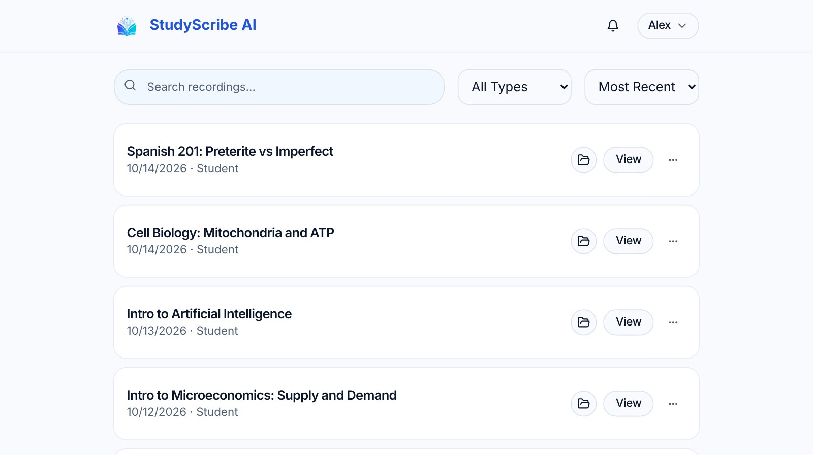

# StudyScribe AI

**Turn lectures and meetings into study material.** Record, upload or paste a link, get a speaker-labelled transcript, and generate notes, flashcards, quizzes, study guides and an AI tutor from it.

**Live app:** [studyscribe-ai.vercel.app](https://studyscribe-ai.vercel.app) · **Demo:** [/demo](https://studyscribe-ai.vercel.app/demo)



## What it does

| | |
| --- | --- |
| **Capture** | Record in the browser (with optional tab or screen audio and live transcription), upload audio or video up to 1 GB, import from a link (including YouTube), or send a note-taker bot to Zoom, Meet or Teams. |
| **Transcribe** | AssemblyAI transcription with speaker labels, automatic language detection and custom vocabulary. Search, comment, highlight, rename speakers and export to TXT, SRT or VTT. |
| **Study** | AI notes from templates, flashcards with spaced repetition, quizzes, study guides, key terms and chapters, tasks and due dates, exam packs across many recordings, a study planner and progress tracking. |
| **Ask** | An AI tutor for each recording, and Ask StudyScribe across your whole library and uploaded files (PDFs, slides, documents) with cited, clickable answers. |
| **Organise** | Courses, tags, a Files library, standalone notes, bookmarks and offline review. |
| **Share** | Public links, view/comment/edit sharing, study groups, teams with SSO, emailing notes to meeting attendees, Notion and Google Docs export, webhooks and a public API. |

The interface is available in English, Spanish, French, Simplified Chinese, Japanese and Korean.

## Apps in this repo

| App | Folder | Notes |
| --- | --- | --- |
| Web app and API | `client/`, `server/`, `shared/` | The main product, deployed to Vercel. |
| Mobile app | [`mobile/`](mobile/README.md) | Expo (iOS and Android). |
| Desktop app | [`desktop/`](desktop/README.md) | Electron (Mac, Windows, Linux). |
| Chrome extension | [`extension/`](extension/README.md) | Import a page or record a tab. |

## Tech stack

- **Frontend:** React 19, Vite, [wouter](https://github.com/molefrog/wouter), TanStack Query, shadcn/ui and Tailwind v4
- **Backend:** Express and [tRPC](https://trpc.io), plus REST routes for auth, webhooks and the public API
- **Database:** TiDB Cloud (MySQL-compatible) with [Drizzle ORM](https://orm.drizzle.team)
- **AI:** AssemblyAI for transcription, any OpenAI-compatible API for generation and embeddings
- **Services:** Cloudflare R2 or Vercel Blob (storage), Resend (email), Stripe (billing), Recall.ai (meeting bots), WorkOS (SSO), Web Push

## Getting started

Requires Node 22.

```bash
npm install --include=dev --no-audit --no-fund
npm run dev        # Express + Vite on the first free port from 3000
```

For local development you need `JWT_SECRET`, `PUBLIC_APP_URL` (e.g. `http://localhost:3000`) and a database connection (`DATABASE_URL`, or the `TIDB_*` / `DB_*` variables). Everything else is optional and switches its feature off when missing:

| Variable | Turns on |
| --- | --- |
| `ASSEMBLYAI_API_KEY` | Transcription (`ASSEMBLYAI_WEBHOOK_SECRET` for webhook mode) |
| `OPENAI_API_KEY`, `OPENAI_BASE_URL`, `OPENAI_MODEL` | AI notes, flashcards, quizzes, tutor and Ask |
| `OPENAI_EMBEDDING_MODEL` | Smart search |
| `GOOGLE_CLIENT_ID`, `GOOGLE_CLIENT_SECRET` | Google sign-in, Calendar and Docs export |
| `R2_*` or `BLOB_READ_WRITE_TOKEN` | File storage ([R2 setup](docs/storage-r2.md)) |
| `RESEND_API_KEY`, `RESEND_FROM_EMAIL` | Email |
| `STRIPE_*` | Paid plans |
| `VAPID_PUBLIC_KEY`, `VAPID_PRIVATE_KEY` | Browser push |

Mock servers in `scripts/dev/` stand in for AssemblyAI, OpenAI, Stripe, Google and the rest so you can run every feature without keys. See [CLAUDE.md](CLAUDE.md) for the commands.

### Commands

```bash
npm run build       # production build (client + server bundle)
npm start           # run the built standalone server
npm run check       # TypeScript
npm test            # Vitest
npm run format      # Prettier
npm run db:migrate  # apply committed migrations in drizzle/
npm run evals       # AI quality checks (see evals/README.md)
```

## Project structure

```
client/        React web app (pages, components, hooks, i18n)
server/        Express app, tRPC routers, auth, provider integrations
shared/        Code shared by client, server and mobile (plans, languages, translations)
drizzle/       Database schema and SQL migrations
api/           Vercel serverless entry point
mobile/        Expo mobile app
desktop/       Electron desktop app
extension/     Chrome extension
scripts/       Dev mock servers, demo video and screenshot pipelines, YouTube relay, DB tools
evals/         AI quality eval cases and baseline
docs/          Handoff notes, plans, guides, security and compliance
patches/       Package patches (pnpm)
tools/         Vendored Claude skill tooling
```

Start with [docs/README.md](docs/README.md) for the documentation index and [CLAUDE.md](CLAUDE.md) for a detailed architecture walkthrough.

## Desktop app

StudyScribe AI also runs as its own app on Mac, Windows and Linux (`desktop/`, built with Electron). It opens the live site in its own window and adds what a browser tab can't: recording your computer's audio along with the microphone, and an always-on-top Study help window (View > Study Help Window, Cmd/Ctrl+Shift+H).

To build it and install it on a Mac:

```bash
cd desktop
npm install
npm run build
npx electron-builder --mac dir --arm64      # or: npm run dist:mac for a DMG
cp -R "release/mac-arm64/StudyScribe AI.app" ~/Applications/
```

Then open **StudyScribe AI** from `~/Applications` (drag it to the Dock or the Desktop to keep it handy). Unsigned builds may need right-click > Open the first time.

**Google sign-in uses your own browser.** "Continue with Google" opens in Chrome (or your default browser when Chrome isn't installed), where your Google accounts are already signed in, so you just pick one. The browser then asks to open StudyScribe AI, and the app finishes signing in. Set `"signInBrowser": "default"` in `~/Library/Application Support/StudyScribe/settings.json` to use your default browser (for example Safari) instead.

See [desktop/README.md](desktop/README.md) for system audio, security settings, signing and releases.

## Deployment

Production runs on Vercel and deploys automatically on every push to `main`. Database migrations are not applied on deploy: run `npm run db:migrate` against the production database after merging a change that adds one. Railway and Render configs (`railway.json`, `render.yaml`, `Procfile`) are kept from an earlier evaluation and are not the active deployment.

## License

[MIT](LICENSE) © 2026 Jason Loo
